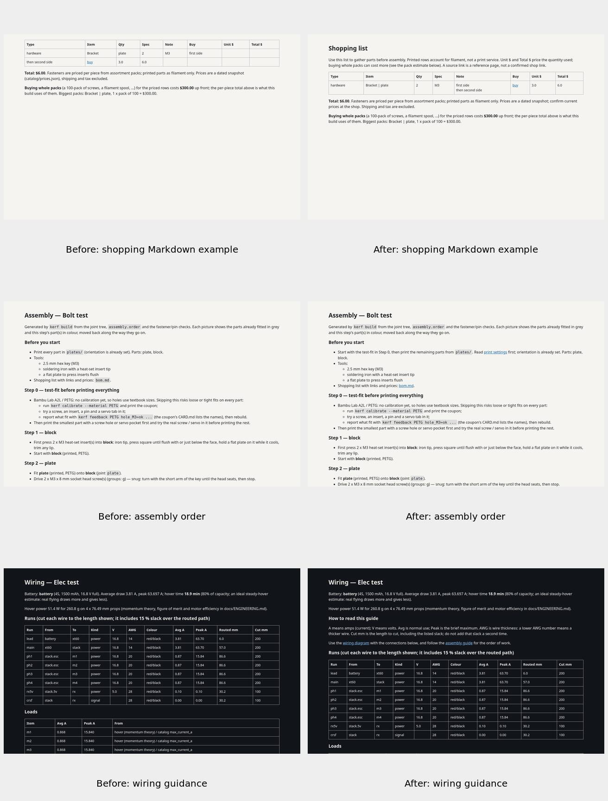

# Setup recovery and first-build handoff

These are generated example documents rendered as Markdown, with identical geometry, prices, ratings and input rows before/after. Changed documents were inspected at desktop/phone sizes in light and dark themes; full captures stay outside Git. The examples are test data, not new vendor price research.

- Setup reports missing Node/npm before installing Python dependencies. The locked Playwright installer checks its own Chromium revision and headless shell on every setup retry, repairing stale/interrupted browser caches while remaining a no-op on the current cache.
- Both Mac dependency stamps include package-lock.json. Cached launches skip setup; changing only that lockfile runs setup again. Offline/dirty update attempts preserve local files, explain why updates were skipped, and still start Studio. Native single-window behavior is preserved.
- The shopping guide explains per-piece versus whole-pack costs before the table and flags incomplete budgets up front. Pipes/newlines/HTML characters no longer corrupt table cells or budget/pack notes. URL punctuation is encoded, invalid links are not executable, and CSV values and price calculations are unchanged.
- Assembly starts with test-fitting before printing the rest and links to the shopping/print/bring-up guides. Purchased-only assemblies no longer invent a print/test-fit step.
- Wiring explains A/V/AWG and the already-computed cut length/slack, and links to the diagram and assembly guide. No currents, voltages, lengths or ratings changed.

Tests use isolated command stubs for installer/launcher failure paths; no firmware tools, global packages, physical printer or paid services are installed by those tests. The real locked browser-install command was exercised successfully against the current cache. Targeted handoff/setup/launcher tests pass; no full suite or all-project build is required by this round.
