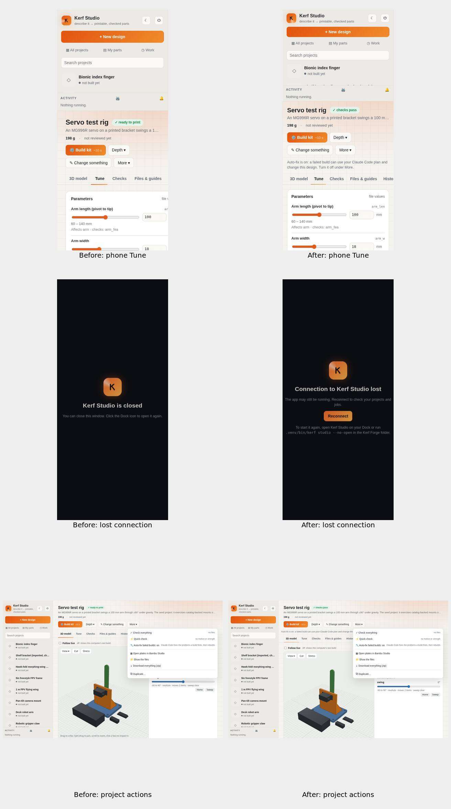

# Studio usability evidence

Desktop: 1280×800. Phone: 390×844. Both light and dark themes were inspected. Before uses main's Studio HTML at 2a74bc2 against the same built project outputs as After.

The complete 60-pair capture is linked in [PR #1](https://github.com/Schponken/kerf-forge/pull/1). The original review capture is available in [the original review commit](https://github.com/Schponken/kerf-forge/blob/3ff209dd3754710e0450e952de45f014cf23d328/docs/usability/2026-11-02/README.md), outside this branch's retained history. Activity failure and sign-in examples use the real UI rendering with simulated responses; no printer sends or paid design jobs were started.

[Findings and outcomes](FINDINGS.md)
