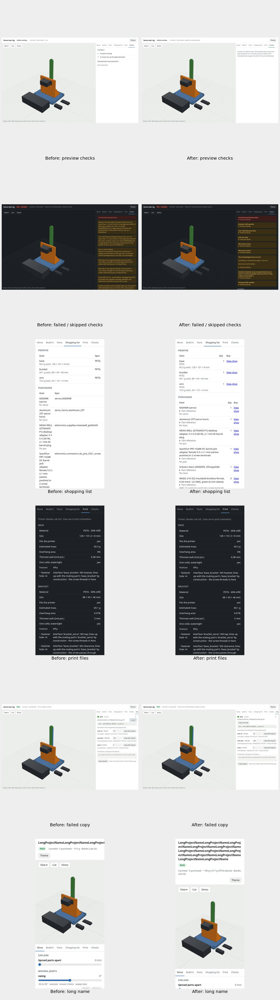

# Assembly viewer usability round

Changed states were inspected at 1280×800 and 390×844 in light and dark themes. Captures use the same meshes, report values and geometry. The preview fixture intentionally has no completed checks or print package. Clipboard denial is simulated; no system clipboard or paid service is required by the tests.

- Preview checks no longer claim that parts do not overlap before checking them. Pending shopping/print tabs explain what to wait for and how to load the completed file. Any already-known blocking problem remains visible.
- Failed motion sweeps say they collide; skipped checks have a neutral “not checked” marker. Their values and thresholds are unchanged.
- The writer now carries the report's device/off-board mass split: the Servo test rig shows 198 g on the device and 317 g off it, rather than incorrectly adding both into its device weight.
- Shopping rows open buying links. Internal catalog references are retained under Part reference; readable specifications remain visible. Print plates link to their generated files and give the slicing/review next step.
- Problem/notes cards reuse the existing shared explanation rules without changing Studio's wording or the rule module. Raw diagnostics remain available under Technical details, including fallback behavior for older viewers.
- A failed clipboard API and failed fallback no longer say Copied. The user gets the original text in a manual-copy dialog. Successful fallback still says Copied.
- Long project names and source/part references wrap. An actual phone overflow from 390 to 1713 pixels is covered by browser regression checks.

Tests: tests/test_viewer.py, tests/test_viewer_usability.py, tests/test_maker_output.py, tests/test_explain.py. The new browser test runs both sizes and themes, checks safe supplier links and plate paths, and verifies that previews retain errors without false success indicators. Full-size captures remain outside the checkout under /workspace/usability/viewer-round/; only this compressed sheet is retained in Git.
